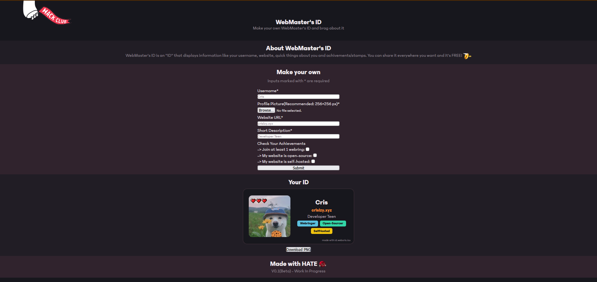

# WebMaster's ID
A project for [Embassy](https://embassy.hackclub.com)


**Live site:** [https://id.webcris.icu](https://id.webcris.icu)

## Run locally

*1.Clone*

```bash
git clone https://github.com/crislazy/webmastersid
cd webmastersid
```

*2.Run*

You can open `index.html` in your browser or run it using:
```bash
npx http-server .
```

## Built with

HTML, CSS, JavaScript, [html2canvas](https://html2canvas.hertzen.com/)

> Note: This project is work in progress

## Screenshots

*How the website looks*



*An example of the ID*


## Credits
- Font: Phantom Sans by Hack Club
- License: MIT
